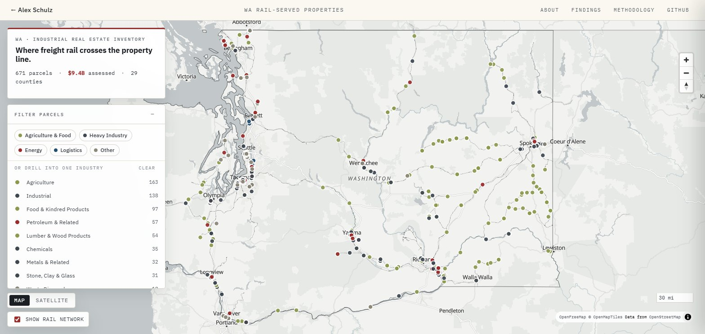

# wa-rail-properties

An interactive inventory of every parcel in Washington State with private rail access.



**Live site:** https://aschulz714.github.io/wa-rail-properties/

## What's here

- 671 rail-served parcels mapped from the U.S. Bureau of Transportation Statistics North American Rail Network (NARN) crossed against Washington State parcel data
- $9.4B in assessed value across the 526 parcels with a value above zero
- 29 counties · 15 industry categories · 479 unique owners
- Filters by 5 industry tiers and individual category drill-down
- Live-computed statistics and findings — no precomputation

## Stack

- Plain HTML/CSS/JS, single file, no build step
- MapLibre GL JS against OpenFreeMap basemap (no token, no tracking)
- IBM Plex Sans + IBM Plex Mono via Google Fonts

## Run locally

```bash
python -m http.server 8002
# open http://localhost:8002/
```

The page fetches GeoJSON from `data/`, so it has to be served — opening `index.html` via `file://` will fail.

## Data vintage

2022-02-15 parcel attribute snapshot. Refreshed UI in 2026.

## Author

Alex Schulz · CPA + GEOINT · [portfolio](https://github.com/aschulz714/alex-schulz)
